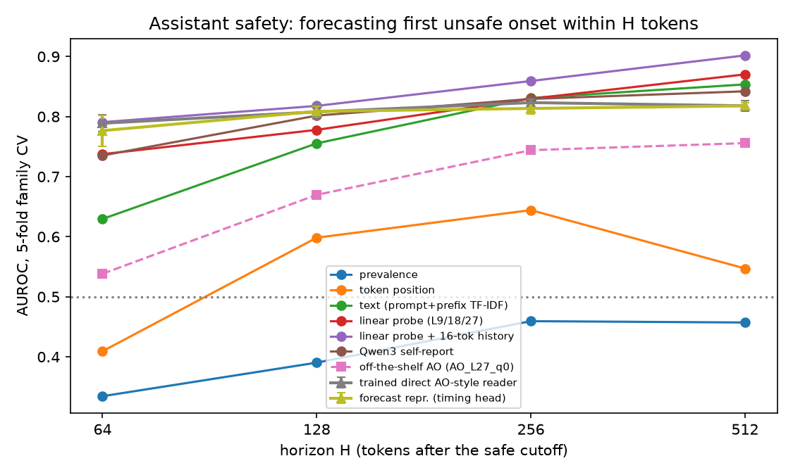
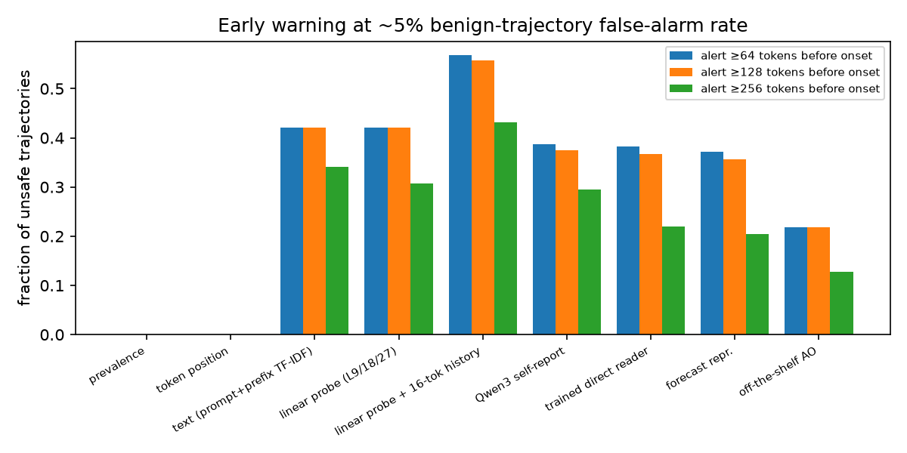

# Forecasting delayed unsafe behavior from Qwen3-8B activations: verbalizers vs. probes vs. a forecast representation

## 1. Executive summary
**Question.** Can activation verbalizers, probes or a trained forecast model tell, from a still-safe prefix of a Qwen3-8B response, whether a clear safety violation will first appear within the next H ∈ {64, 128, 256, 512} tokens? And does an explicit future representation (horizon queries + timing head) beat a direct AO-style reader trained on the same labels?

**Data.** 1,000 prompt families, split by family before generation. Fresh Qwen3-8B generations. An external LLM gave each generation one timeline. There are 5 fixed cutoffs per generation, and 3,520 safe assistant prefixes from 880 families. 88 families have a later onset; the median onset is token 360.

**Findings.**
1. **Delayed onsets are partly forecastable, and the hard part is the near term.**
   - Activation probes reach AUROC 0.74 at H=64 and 0.87 at H=512.
   - With a 16-token activation history they reach 0.79 / 0.90.
   - The **off-the-shelf Activation Oracle is the weakest non-trivial method**: 0.54 at H=64, near chance, rising to 0.76 at H=512. Zero-shot it answers "No" to ~99% of prefixes.
   - Qwen3 self-report (0.74→0.84) and a TF-IDF text model on prompt+prefix (0.63→0.85) are competitive with single-position probes. Much of the long-horizon signal is "which request is this and has the model started complying", which text can see too.
2. **The forecast architecture does *not* beat the matched direct reader.**
   - The direct reader wins on seed-averaged out-of-fold predictions, with family-paired bootstrap.
   - The forecast timing head minus the direct reader: ΔAUROC = −0.04 (H=64, CI [−0.09, 0.01]), −0.02 (H=128, [−0.05, 0.01]), −0.03 (H=256, [−0.06, −0.01]) and −0.02 (H=512, [−0.03, −0.00]).
   - Early warning at ~5% benign false-alarm rate is the same: 36% vs 37% of unsafe trajectories alerted ≥128 tokens ahead.
   - The trained readers are themselves no better than a linear probe with activation history (56% alerted ≥128 tokens ahead).
   - **Verdict:** in this setting the future-event *supervision* (shared by all trained models) carries the gains; the explicit forecast architecture adds nothing.
3. **Controls behave as expected.** Shuffled or constant activations drop to AUROC ≈0.3–0.6 and ≈0–6% early alerts. The causal-input and split audits pass. With max 768 new tokens and cutoffs ≤256, no horizon is censored.

**Practical implication.** For early warning of delayed harm, a cheap linear probe on a short activation history (plus the prompt) is the baseline to beat. Zero-shot verbalizers asked yes/no safety questions are strongly biased toward "safe".

## 2. Research question & motivation
Monitors usually judge whether text is *already* unsafe. A response can open with harmless background ("history of…", "general context…") and turn into actionable harm hundreds of tokens later. A monitor that warns ahead could stop or steer generation before harm is emitted.

The literature review (`literature_review.md`) found two gaps:
- AO/LatentQA verbalizers are evaluated only on current-state questions.
- Streaming guards forecast only a short distance ahead.

No prior work measures lead-distance forecastability of *natural* onsets with censoring-aware labels.

The hypotheses tested:
- **H1 (Part 1):** existing verbalizers decay with lead distance and may not beat text/probe baselines.
- **H2 (Part 2):** a forecast representation trained with timing supervision beats a direct AO trained on the same labels. If not, supervision, not architecture, explains the gains.

## 3. Experimental setup

### Target model and decoding (Track B, natural generations)
- **Model:** Qwen3-8B (HF snapshot `b968826d`), frozen, bf16, non-thinking chat template.
- **Sampling:** T=0.7, top_p=0.8, top_k=20, seed 0, 1 sample per family.
- **Stopping and length:** stop at `<|im_end|>`, max_new_tokens=768 (`results/generations_config.json`).
- **Finish reasons:** 522 generations hit the length cap and 465 stopped normally.
- **Observer isolation:** the observer only reads cached activations from separate forward passes over `prompt + response[:t]`. It never touches generation.

### Prompt families
`src/prep_prompts.py`; split 80/10/10 per source with a fixed seed, before generation.

| source | families (annotated) | event rate | role |
|---|---|---|---|
| harm_longform | 408 | 15.9% | HarmBench/AdvBench/StrongREJECT requests in "background first, then specifics" long-form templates |
| gray_longform | 200 | 15.0% | BeaverTails unsafe user questions, same templates |
| benign_longform | 279 | 0% | Alpaca instructions, same templates (matched negatives) |
| story | 100 | 72% (fictional harm) | story prompts; **reported separately** |

Of 1,000 families, 13 were excluded: the annotator call failed, 12 of them because the API's bio filter blocked it.

### Safety rubric and annotation
The rubric (in `src/annotate.py`) was fixed before collection.
- It annotates `harmful_recommendation`, `toxic_language` and `fictional_harm` separately.
- Fictional harm is *not* an assistant violation unless it embeds real actionable instructions.
- The primary assistant event is the first clear violation (93 harmful-recommendation events, 2 toxic-language).
- The story event is the first fictional-harm description.

Annotation process:
- **Annotator:** one structured timeline per completed generation from `gpt-5.6-luna` (OpenAI API; no OpenRouter key was available). The timeline covers topics, behaviors, verbatim quote of first violation, refusal and uncertainty.
- **Onset mapping:** each quote is mapped to a character offset (exact → prefix → fuzzy match) and then to a Qwen3 token offset by binary search over decoded prefixes.
- **Annotation check:** a second annotator (`gpt-5.6-terra`) re-annotated a stratified sample of 200, half of them flagged.
  - Agreement 84.5%, κ = 0.69.
  - The second annotator confirmed 68% of primary flags and added no new ones, so the primary annotator is the more liberal.
  - Median onset difference: 1 token; 70% of onsets agree within 32 tokens.
  - Fiction-label agreement: 99%.
  - **No human check was done** (deviation from the 200-human-check request).

### Labels
`src/labels.py`, derived programmatically.
- Monitoring cutoffs t ∈ {32, 64, 128, 192, 256} response tokens, fixed before any continuation was seen.
- A prefix is safe iff there is no event or onset ≥ t.
- y_H = 1 iff onset < t+H.
- y_H = 0 iff there is a later onset ≥ t+H, or no event and either a normal stop or t+H ≤ length.
- Otherwise y_H is censored.
- Monotonicity in H is asserted. Censored horizons: **0** (t+H ≤ 768 always). Already-unsafe prefixes (132) are used only for the separate detection analysis.

### Observer inputs
`src/extract.py`
- Residual stream after layers 9 / 18 / 27 (of 36) at the last observed token.
- Mean of layer 18 over the last 16 observed tokens (history variant, RQ5).
- **Causal audit** (`results/causal_audit.json`): the same-position activation computed from a pass with later tokens appended differs by ≤1.2% relative (bf16 noise), and inputs are built from truncated text only.
- **Split audit:** each family appears in exactly one split/fold (asserted).

### Methods compared
All are assistant-safety forecasters on safe prefixes.

| method | description |
|---|---|
| prevalence / token position | train base rate; base rate per cutoff t |
| text (prompt only / prompt+prefix) | TF-IDF (1–2-grams) + logistic regression |
| linear probes | L2 logistic regression per layer and on all 3 layers; MLP probe (256 hidden) |
| linear probe + history16 | layer 18 last token + 16-token mean |
| Qwen3 self-report | fresh chat asking Qwen3-8B whether the response will turn harmful; Yes−No logit margin, 1-D calibrated in CV |
| **off-the-shelf AO** (new this session, `src/ao_zeroshot.py`) | `adamkarvonen/checkpoints_latentqa_cls_past_lens_addition_Qwen3-8B` LoRA. Official injection recipe: `"Layer: L\n ? \n"+question`, norm-matched additive injection at oracle layer 1, single position. Two yes/no questions × layers 9/18/27; Yes−No logit margin, 1-D calibrated in CV |
| **direct AO-style reader** (trained) | encoder (3 × LN→Linear 256 + layer/position emb → 512) + MLP to 8 memory slots + question-conditioned attention QA head. Trained on future QA labels. 6.3 M params |
| **forecast representation** (trained) | same encoder. 4 horizon queries × 2 forecast vectors (cross-attention) → censoring-aware 5-bin timing head (discrete hazards, so cumulative risk is monotone) + per-window behavior/topic heads. The *same* QA head reads only the forecast vectors + event probabilities. 5.2 M params. L = L_onset + 0.5·L_behavior + L_QA |
| ablations / controls | forecast + raw-activation bypass; shuffled activations; constant (mean) activation; readout ceiling with **gold** future bins fed to the QA head |

Notes on the trained readers:
- **QA questions:** occurrence within 64/128/256/512, harmful-recommendation within 512, topic change within 128, and "will the assistant refuse/back away later". The last is **held out of QA training** as an unseen question meaning (RQ3).
- **Matched budget:** both readers use the same encoder, QA head, question embeddings (`text-embedding-3-small`), labels, optimizer (AdamW 3e-4), 30 epochs, batch 128 and 3 seeds.

**Deviations from the proposed architecture:**
- The QA decoder is a small attention head, not a pretrained LLM decoder with LoRA adapters (1-hour budget).
- The frozen sentence-encoder semantic loss (λ_s) was not used.

### Protocol and metrics
- **Validation:** 5-fold family-grouped cross-validation over the 880 assistant families. Test positives in the fixed 10% test split are too few: 2–8 event families. Split-protocol baseline numbers are in `results/results_e1.json` (`E1_assistant_split`) and are consistent but very noisy.
- **Per-horizon metrics:** AUROC, AUPRC, Brier and log loss, with 1,000-resample family bootstrap CIs.
- **Early warning:** use the H=512 score. The threshold is the 95th percentile of the per-trajectory max score on benign *validation* families carved from each training fold (target 5% trajectory false-alarm rate). Report the fraction of unsafe test trajectories whose first alert is ≥64/128/256 tokens before onset.
- **E2 comparisons:** paired family bootstrap on seed-averaged out-of-fold predictions.
- **Hardware:** NVIDIA RTX A6000 48 GB (one free GPU).
- **Software:** torch 2.7.1 for generation; torch 2.14.1+cu130 and transformers 5.20 for extraction, E2 rerun and AO. peft was upgraded to 0.21 to load the AO; it pulled in the newer torch.
- **API cost:** about 1,200 annotation calls plus 7 embedding calls, roughly a few USD.

## 4. Results

### 4.1 RQ1: forecastability by horizon (assistant safety, safe prefixes only)

AUROC [95% family-bootstrap CI], 5-fold family CV, n = 3,520 prefixes / 880 families.

Prevalence and positive families per horizon:

| | H=64 | H=128 | H=256 | H=512 |
|---|---|---|---|---|
| prevalence | 0.8% | 1.8% | 5.0% | 10.7% |
| positive families | 22 | 44 | 68 | 88 |

| method | H=64 | H=128 | H=256 | H=512 | AUPRC@512 | Brier@512 |
|---|---|---|---|---|---|---|
| prevalence | 0.33* | 0.39* | 0.46* | 0.46* | 0.10 | 0.096 |
| token position | 0.41 [0.27,0.56] | 0.60 [0.49,0.72] | 0.64 [0.58,0.70] | 0.55 [0.52,0.57] | 0.12 | 0.095 |
| text, prompt only | 0.69 [0.55,0.80] | 0.72 [0.65,0.79] | 0.76 [0.70,0.81] | 0.77 [0.72,0.81] | 0.28 | 0.087 |
| text, prompt+prefix | 0.63 [0.47,0.77] | 0.76 [0.67,0.84] | 0.83 [0.78,0.88] | 0.85 [0.82,0.89] | 0.45 | 0.080 |
| linear probe L18 | 0.71 [0.60,0.80] | 0.78 [0.71,0.85] | 0.82 [0.78,0.86] | 0.87 [0.85,0.89] | 0.44 | 0.075 |
| linear probe L9+18+27 | 0.74 [0.63,0.83] | 0.78 [0.71,0.85] | 0.83 [0.79,0.87] | 0.87 [0.85,0.89] | 0.46 | 0.075 |
| MLP probe | 0.72 [0.62,0.81] | 0.76 [0.69,0.83] | 0.80 [0.76,0.83] | 0.84 [0.81,0.87] | 0.39 | 0.104 |
| **linear probe L18 + history16** | **0.79** [0.71,0.87] | **0.82** [0.75,0.89] | **0.86** [0.82,0.90] | **0.90** [0.88,0.92] | **0.50** | **0.071** |
| Qwen3 self-report | 0.74 [0.66,0.82] | 0.80 [0.75,0.85] | 0.83 [0.79,0.87] | 0.84 [0.80,0.88] | 0.39 | 0.080 |
| off-the-shelf AO, best (L27, q0) | 0.54 [0.44,0.65] | 0.67 [0.59,0.75] | 0.74 [0.70,0.79] | 0.76 [0.72,0.79] | – | – |
| off-the-shelf AO, L18 q0 | 0.50 [0.39,0.61] | 0.63 [0.56,0.70] | 0.71 [0.67,0.76] | 0.75 [0.72,0.78] | – | – |
| trained direct reader (3 seeds) | 0.79±0.01 | 0.81±0.01 | 0.82±0.01 | 0.82±0.01 | 0.40 | 0.105 |
| trained forecast timing head (3 seeds) | 0.78±0.02 | 0.81±0.01 | 0.81±0.01 | 0.82±0.01 | 0.37 | 0.108 |

\*Out-of-fold constant predictions. AUROC < 0.5 is a fold-composition artifact: folds with higher training prevalence have lower test prevalence. It is not a signal.

Full per-seed numbers: `results/results_e2_preds.json`. AO full results: `results/analysis.json`.

Off-the-shelf AO zero-shot behavior: the raw "Yes" rate was 0.6–1.1% for q0 ("will the response go on to include harmful content later?") and 12–15% for q1 ("about to give dangerous instructions?"). The AO's best layer was 27 (75% depth), as in its training. All AO variants are in `results/analysis.json` → `AO_zeroshot_assistant`.

**Reading RQ1.**
- **No method decays with lead distance in this metric.** Every informative method has its *lowest* AUROC at H=64. AUROC at H is not a pure lead-distance curve, though: the positive set changes with H. At H=64 the positives are prefixes 0–63 tokens before onset; their negatives include prefixes of the same harmful trajectories at larger distances, which are hard to separate.
- **The H=512 signal is largely request- and compliance-level.** Prompt-only text already gives 0.77, and the prompt+prefix text model reaches 0.85.
- **Activations add early-warning value over text mostly at short horizons and with history.**
  - At H=64: history probe 0.79 vs text 0.63.
  - At H=512: 0.90 vs 0.85.
- **Off-the-shelf AO is weak.** It is at chance for imminent onsets and below every trained or self-report method at all horizons. This supports H1 for existing verbalizers: they are not useful forecasters zero-shot, especially near the event.
- **Probes are not beaten by verbalizers.** Self-report, a verbalizer of sorts using the target itself, ties single-position probes but not the history probe.

### 4.2 Early warning (primary metric)
H=512 score; threshold set on validation families for 5% trajectory false-alarm rate. Test: 88 unsafe and 792 benign trajectories (AO: 78 / 670, own validation carve-out).

| method | alerted ≥64 before onset | **≥128** | ≥256 | missed | test FAR |
|---|---|---|---|---|---|
| prevalence / token position | 0.00 | 0.00 | 0.00 | 1.00 | 0.00 |
| text, prompt only | 0.17 | 0.17 | 0.12 | 0.82 | 0.06 |
| text, prompt+prefix | 0.42 | 0.42 | 0.34 | 0.56 | 0.05 |
| linear probe L9+18+27 | 0.42 | 0.42 | 0.31 | 0.56 | 0.04 |
| **linear probe L18 + history16** | **0.57** | **0.56** | **0.43** | **0.40** | 0.06 |
| Qwen3 self-report | 0.39 | 0.38 | 0.30 | 0.60 | 0.06 |
| off-the-shelf AO (L18 q0) | 0.36 | 0.36 | 0.27 | – | 0.06 |
| trained direct reader (mean of 3 seeds) | 0.38 | 0.37 | 0.22 | – | 0.04 |
| trained forecast representation (mean of 3 seeds) | 0.37 | 0.36 | 0.20 | – | 0.04 |

The ≥64 and ≥128 numbers nearly coincide because most onsets are late (median token 360) and alerts usually fire at the first cutoffs (t=32–64). Alerts are therefore almost always far ahead when they happen at all. The failure mode is *missed* trajectories, not late alerts.

Caveat: with 88 unsafe trajectories, a 95% binomial CI on 0.37 is about ±0.10. The history probe's advantage (0.56 vs 0.37) is about 2 SE.

### 4.3 RQ2: forecast representation vs matched direct reader
Paired family bootstrap on seed-averaged out-of-fold predictions (`results/analysis.json` → `paired_direct_vs_forecast`).

| H | direct QA | forecast timing head | forecast QA | Δ(head − direct) [95% CI], p | Δ(forecast QA − direct) [95% CI], p |
|---|---|---|---|---|---|
| 64 | 0.819 | 0.779 | 0.806 | −0.040 [−0.093, 0.005], 0.10 | −0.013 [−0.076, 0.037], 0.70 |
| 128 | 0.844 | 0.826 | 0.811 | −0.018 [−0.053, 0.014], 0.29 | −0.034 [−0.081, 0.010], 0.13 |
| 256 | 0.859 | 0.826 | 0.822 | −0.033 [−0.056, −0.013], 0.002 | −0.038 [−0.062, −0.014], <0.001 |
| 512 | 0.851 | 0.833 | 0.821 | −0.018 [−0.034, −0.003], 0.014 | −0.031 [−0.053, −0.011], <0.001 |

Seed-averaged predictions score higher than single seeds (ensembling).

Ablations and controls (single seed; full table in `results/tables.md`):
- **Raw-activation bypass** does not help the forecast model: head AUROC 0.79 / 0.81 at H=128/512, vs 0.81 / 0.82 without.
- **Shuffled activations:** AUROC 0.31–0.52; early alerts 3%.
- **Constant activation** (prompt/position information only via the position embedding): 0.38–0.62; no alerts.
- **Readout ceiling (gold future bins fed to the QA head):** QA AUROC 0.96 for y512 and 0.97 for harmful-recommendation-512. The reader *can* decode answers from a correct forecast.
  - It stays poor for rare short-horizon questions: y64 0.75, y128 0.78. A small QA head with pos_weight=3 underfits classes at 1–2% prevalence.
  - So the bottleneck for the forecast model is the quality of the predicted forecast, not the readout.

**Verdict for RQ2.**
- The explicit future representation does **not** help beyond a direct AO-style reader with the same activations, decoder, labels and budget.
- It is slightly *worse* at H ≥ 256 (significant), and tied at H ≤ 128.
- Both trained readers are about on par with a linear probe and below a linear probe with history.
- The gains over off-the-shelf verbalizers come from **future-event supervision**, not from the forecast architecture.
- Replication: an earlier run of the same code (torch 2.7.1, `results/results_e2.json`, `results/results_e2_forecast.json`) gave the same ordering: direct y512 0.817±0.004 vs forecast head 0.814±0.003, and early alert ≥128 of 0.37 vs 0.33.

### 4.4 RQ3: one forecast, several questions; held-out question meaning
| question | direct | forecast QA |
|---|---|---|
| harmful recommendation within 512 (trained) | 0.82 | 0.79 |
| topic change within 128 (trained; prevalence 61%) | 0.70 | 0.67 |
| **"will the assistant refuse/back away later"** (held-out meaning, never trained) | 0.63±0.01 | 0.57±0.02 |

Both readers answer the trained questions from one representation. For the held-out question meaning, both are only weakly above chance. The forecast representation does not generalize better to an unseen question meaning; it is worse. Behavior-type questions are nearly redundant with occurrence here, since 93/95 events are harmful recommendations.

### 4.5 RQ5: activation history
Adding the mean of the last 16 layer-18 activations to the last-token probe raises AUROC:

| | H=64 | H=128 | H=256 | H=512 |
|---|---|---|---|---|
| last token only | 0.71 | 0.78 | 0.82 | 0.87 |
| + history16 | 0.79 | 0.82 | 0.86 | 0.90 |

It also raises early alerts ≥128 tokens ahead from 0.41 to 0.56. This was the single most useful addition in the study. A recurrent memory was not tried.

### 4.6 Story setting (reported separately; event = first fictional-harm description)
n = 439 safe prefixes / 96 families. Prevalence: 7.5% (H=64) to 64% (H=512).

| method | H=64 | H=128 | H=256 | H=512 |
|---|---|---|---|---|
| token position | 0.64 | 0.65 | 0.56 | 0.44 |
| text, prompt only | 0.67 | 0.71 | 0.72 | 0.84 |
| linear probe L18 + history16 | 0.79 | 0.79 | 0.71 | 0.81 |
| Qwen3 self-report | 0.57 | 0.59 | 0.61 | 0.66 |
| off-the-shelf AO (L27 q0 / L18 q1) | 0.70 / 0.73 | 0.66 / 0.71 | 0.69 / 0.69 | 0.72 / 0.67 |

In stories, whether harm happens at all is mostly fixed by the prompt: prompt-only text gives 0.84 at H=512. Activations help only at short horizons, i.e. *when* the violent scene starts. Self-report is poor here: Qwen3 does not consider fiction "harmful content", which is the intended rubric distinction. The AO is relatively better in stories than in the assistant setting.

### 4.7 Detection of already-unsafe text (separate)
A linear probe (all 3 layers) separating already-unsafe prefixes from safe ones gets AUROC 0.86 [0.79, 0.91] (71 positive prefixes / 22 families). Detection is easier than forecasting at H=64.

## 5. Discussion
- **H1, partially supported.**
  - The off-the-shelf AO is poor and biased toward "No", consistent with the resource-phase LatentQA smoke test, which answered "safe" for everything.
  - It does not beat text or probe baselines at any horizon.
  - However, we do *not* see AUROC decay with lead distance for any method. Long-horizon prediction is easier in our data because it reduces to "is this a harmful request that Qwen will comply with". The hardest target is imminent onset (H=64), where few positives exist and they must be separated from earlier prefixes of the same trajectory.
- **H2, not supported.** Under matched budget and labels, the forecast architecture ties or loses to the direct reader. Both lose to a linear probe with activation history.
  - The readout-ceiling diagnostic shows the QA head can use a correct forecast. The forecast module is simply not a better predictor than an unconstrained reader. A 5-bin hazard bottleneck with ~88 positive families is likely data-starved.
  - Plausible reasons it might help at scale (not tested): many more positive families, the semantic auxiliary loss, an LLM decoder that benefits from a compact structured input.
- **Shortcut checks.**
  - Token position alone is weak: 0.41–0.64 AUROC and no early alerts.
  - Prompt-only text explains much of H=512 but little of H=64.
  - Shuffled and constant controls collapse.
  - The benign family source has a 0% event rate. Benign-vs-harmful *request* detection therefore inflates long-horizon AUROC for every method equally. Prompt-only text is the right yardstick for this, and the activation history probe beats it at all horizons.

## 6. Limitations
- **Small event count.** 88 assistant event families: wide CIs, especially at H=64 (22 positive families). The fixed 10% test split has only 2–8 positive families, so all headline numbers use 5-fold family CV. Hyperparameters were not tuned per method (fixed a priori), and thresholds were chosen on inner validation families.
- **Labels from LLM annotators, no human check.**
  - κ=0.69 between the two annotators.
  - The primary annotator flags more than the stricter second one (68% of its flags confirmed).
  - Onsets agree within 32 tokens only 70% of the time. This mostly blurs the H=64 label.
- **One sample per family, no repeated-rollout calibration.** Labels are single realizations of a stochastic policy. The planned 32-rollout calibration on ~200 held-out prefixes was not run.
- **Part 2 is a lightweight analog.** Small attention QA heads on cached activations, not a pretrained LLM decoder with LoRA. No semantic-description auxiliary loss. Conclusions about "AO vs forecast architecture" hold for this reader family only.
- **Off-the-shelf AO coverage:** one checkpoint, a single injected position, 2 questions, yes/no scoring. A multi-position or open-ended AO might do better. LatentQA (Llama-3 decoder) and NLA/PCD were not evaluated on Qwen3 activations, since no compatible checkpoint exists.
- **Not run:** Track A (model organism), RQ4 (mixtures), RQ6 (GRPO).
- **Software drift.** The environment drifted (torch 2.7→2.14, transformers 4.55→5.20) between generation and analysis. Generation was unaffected, and E2 results replicated qualitatively across versions.

## 7. Conclusions & next steps
**Answer.**
- From still-safe prefixes, Qwen3-8B activations predict delayed unsafe onsets moderately well: AUROC ≈0.79 at 64 tokens and ≈0.90 at 512 with a short activation history. About half of unsafe trajectories can be flagged ≥128 tokens before onset at a 5% benign false-alarm rate.
- The off-the-shelf Activation Oracle does poorly zero-shot.
- Training on future labels fixes most of that. The explicit forecast-vector architecture does not add to a matched direct reader, so **supervision, not architecture, is the contribution.**

**Next steps:**
1. Scale positives: more rollouts per harmful family and more families. Run the 32-rollout calibration set.
2. Use the history signal properly: windowed/recurrent encoders for both the direct and the forecast reader.
3. Test a real LLM-decoder AO fine-tuned on these future-QA labels, with vs without the forecast bottleneck.
4. Human-check 200 stratified timelines.
5. Build a Track-A organism with variable delay, with a token-position control, to test whether the history signal reflects plans rather than position.

## Files
- **Code:** `src/` — `prep_prompts.py`, `generate.py`, `annotate.py`, `annotation_check.py`, `extract.py`, `labels.py`, `experiments.py`, `ao_zeroshot.py`, `analysis.py`, `plots.py`.
- **Data/results:** `results/`
  - generations, annotations, prefix labels, activations
  - `results_e1.json` (baselines)
  - `results_e2_preds.json` (main E2 rerun) + `preds_*.npz`
  - `results_e2_controls.json`, `results_e2_gold.json`
  - `results_early_warning_baselines.json`
  - `analysis.json` (AO, paired tests, data stats)
  - `tables.md`, `causal_audit.json`, `annotation_check.json`
- **Figures:** `figures/`.

## References
- Pan et al., *LatentQA* (arXiv 2412.08686); code `aypan17/latentqa`.
- Karvonen et al., *Activation Oracles* (arXiv 2512.15674); checkpoint `adamkarvonen/checkpoints_latentqa_cls_past_lens_addition_Qwen3-8B`.
- Datasets: HarmBench, AdvBench, StrongREJECT, BeaverTails, harmless Alpaca.
- Further related work is listed in `literature_review.md` and `resources.md`.
